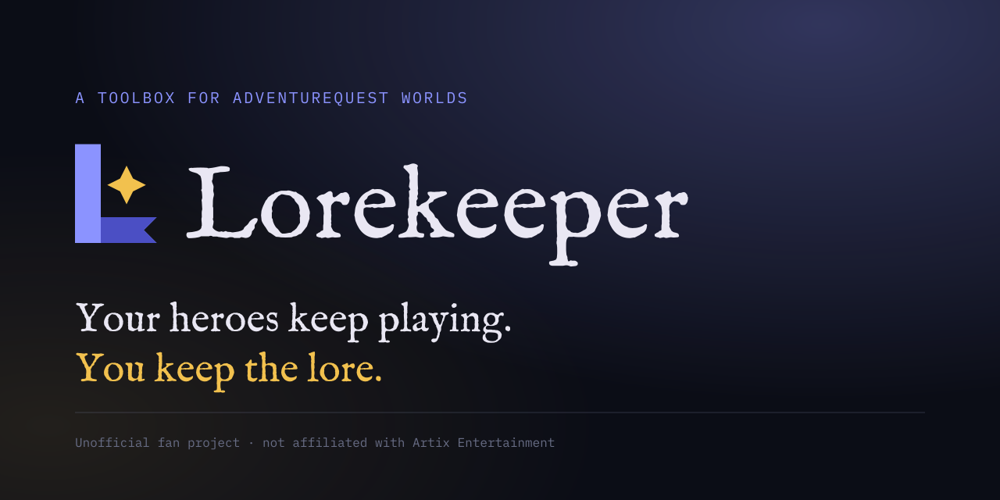

> Lorekeeper is an unofficial fan project. It is not affiliated with, endorsed by or connected to Artix Entertainment.
> AdventureQuest Worlds and all related names and assets are trademarks of Artix Entertainment, LLC.

## Apps

### Desktop

Keeps your characters playing on your own machine. Add your accounts, draw what each hero should do as a script on a
canvas and let them play while you do something else.

### Wiki coming soon

A structured wiki for AdventureQuest Worlds, built from what the game itself says.

## Acknowledgements

Lorekeeper stands on the work of people who mapped the game long before it existed. Thank you:

- [Froztt13/aqw-python](https://github.com/Froztt13/aqw-python), by dwiki08, letsssgoo and contributors: a Python
  bot that talks to the game server directly, and the main reference for how a bot can play over the socket;
- [BrenoHenrike/RBot](https://github.com/BrenoHenrike/RBot): the scriptable bot that showed what AQW automation can do;
- [auqw/Skua](https://github.com/auqw/Skua), by BrenoHenrike, SharpTheNightmare and contributors: RBot's successor and
  the bot most of the community plays with today;
- [133spider/AQLite](https://github.com/133spider/AQLite): an open client for AQWorlds, useful to understand the game's side
  of the conversation.

Lorekeeper shares no code with these projects; it is a separate implementation in PHP.

## License

[MIT](LICENSE)
